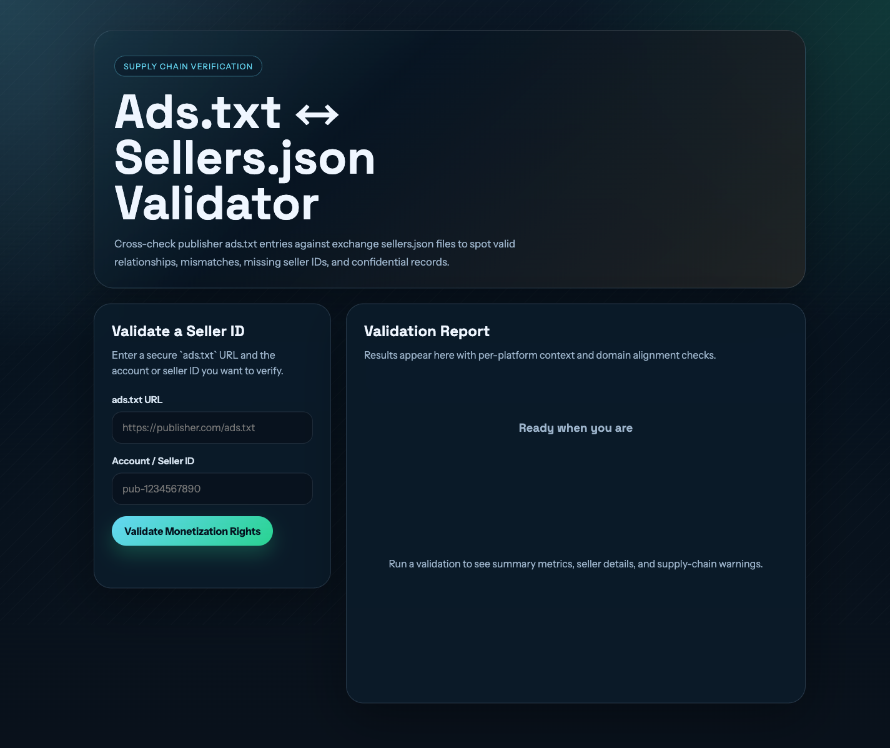

# Ads.txt ↔ Sellers.json Validator

A small web tool that verifies a publisher's declared monetization rights by cross-referencing two IAB Tech Lab transparency files: the publisher's `ads.txt` and each ad system's `sellers.json`.

You give it an `ads.txt` URL and an account/seller ID. It finds every line in that `ads.txt` claiming the ID, then fetches the corresponding `sellers.json` from each ad system and checks that the two files tell the same story.



## What it checks

For each matching `ads.txt` entry, the validator reports one of four statuses:

| Status | Meaning |
|---|---|
| **Valid** | The `ads.txt` relationship matches the `seller_type` declared in `sellers.json`. |
| **Mismatch** | Both files list the seller, but the relationship and `seller_type` disagree. |
| **Not Found** | The seller ID is absent from the ad system's `sellers.json`. |
| **Unreachable** | The `sellers.json` file could not be fetched, parsed, or validated. |

The relationship rules applied are:

- `DIRECT` in `ads.txt` expects `PUBLISHER` or `BOTH` in `sellers.json`
- `RESELLER` in `ads.txt` expects `INTERMEDIARY` or `BOTH` in `sellers.json`

Alongside the status, each result also surfaces:

- **Domain alignment** — whether the seller's declared `domain` matches the publisher domain the `ads.txt` was served from
- **Confidential sellers** — entries flagged `is_confidential: 1`, where the ad system withholds seller name and domain
- **Endpoint used** — whether the standard `https://{adsystem}/sellers.json` path was used or a known non-standard override (Google, for example, publishes its `sellers.json` from a Google Cloud Storage endpoint)
- **Raw source line** — the original `ads.txt` line and its line number

Results can be copied as JSON from the UI for use elsewhere.

## Bid request supply-chain audit

A second panel audits a pasted or uploaded OpenRTB bid request instead of a bare ads.txt
URL and account ID. Paste the JSON (or drop a `.json` file up to 5 MB) and the browser
extracts only `id`, `site`, `app`, `dooh` and `source` before sending anything to the
server — `device`, `user`, `regs` and `imp` never leave the page.

The server walks every node in the bid request's supply chain object
(`source.ext.schain`, or `source.schain`) and, for each hop, checks:

- the ad system's `sellers.json` is reachable
- the seller ID from the chain node is present in it
- the declared `seller_type` is valid for that hop's position (`DIRECT` for the first hop, `RESELLER` after)
- the hop's seller domain links back to the previous hop's ad system domain (the chain link check)
- the hop is declared in the publisher's or app developer's `ads.txt`/`app-ads.txt`
- when the request names an inventory partner (`site.inventorypartnerdomain` / `app.inventorypartnerdomain`, OpenRTB 2.6), the owner's file must carry an `INVENTORYPARTNERDOMAIN=<partner>` line authorizing the arrangement, and the hop counts as declared if either the owner's or the partner's file lists it
- the first hop's seller domain aligns with the publisher/app domain

Each hop is rendered as `pass`, `broken`, or `unverifiable` — `unverifiable` is not a soft
failure, it means the hop genuinely could not be checked (a confidential seller record, or
an unreachable `sellers.json`). The result is shown as a flow diagram plus per-hop detail,
with links back to every `ads.txt`/`app-ads.txt` and `sellers.json` source file used.

For app inventory, the server works out where `app-ads.txt` lives in this order:
`app.domain` from the bid request; a small curated map; then the store named by
`app.storeurl` — Apple via its lookup API (numeric App Store IDs and reverse-DNS bundle
IDs are both handled), and Roku, LG and Samsung via the IAB
`<meta name="appstore:developer_url">` tag their listings publish. Amazon's listings carry
the same tag but turn away server-side requests, so Fire TV apps need `app.domain` or a
domain entered by hand. A bundle is only ever looked up in the store its `storeurl` names.

If a bid request has no supply chain to audit, or the app's developer domain can't be
resolved automatically, the panel asks for what it needs (or hands you back to the
ads.txt form above, which takes a full URL and account ID).

## Why it needs a server

Most adtech servers do not send CORS headers, so a browser cannot fetch `ads.txt` or `sellers.json` files directly from another origin. All outbound requests are therefore proxied through the Express backend. A purely static version of this tool is not possible.

## Requirements

- **Node.js 18 or newer** (uses `net.BlockList`, `String.prototype.replaceAll`, and the built-in `node --test` runner)
- **npm** (ships with Node.js)
- Outbound HTTPS internet access — the server fetches live `ads.txt` and `sellers.json` files

No database, API keys, or accounts are required.

## Setup

```bash
git clone https://github.com/willlightningstrike/ads_txt_scraper.git
```

```bash
cd ads_txt_scraper
```

```bash
npm install
```

## Running the app

Start the server:

```bash
npm start
```

Then open **http://localhost:3000** in your browser.

For development with automatic restarts on file changes:

```bash
npm run dev
```

To stop the server, press `Ctrl+C` in the terminal.

## Using it

1. Enter an `ads.txt` URL. It must be a full **HTTPS** URL — for example `https://www.example-publisher.com/ads.txt`.
2. Enter the account or seller ID you want to verify — for example `pub-1234567890`.
3. Click **Validate Monetization Rights**.
4. Review the summary counts at the top, then the per-entry cards below. Click **Copy JSON** to copy the full result payload.

If the seller ID does not appear anywhere in the `ads.txt` file, the report says so and no `sellers.json` lookups are performed.

## Running the tests

```bash
npm test
```

The suite runs on Node's built-in `node --test` runner and currently has 134 tests across ten files, covering the SSRF/URL-validation layer (private IP detection, IPv6 handling, DNS pinning), ads.txt and sellers.json parsing, the `sellers.json` LRU/TTL cache, OpenRTB bid-request extraction and supply-chain auditing, app-developer-domain resolution, and route-level tests for both `POST /api/validate` and `POST /api/audit-chain`.

## Configuration

All settings are optional environment variables:

| Variable | Default | Purpose |
|---|---|---|
| `PORT` | `3000` | Server listen port |
| `HOST` | `127.0.0.1` | Server bind address |
| `REQUEST_TIMEOUT_MS` | `20000` | Timeout for outbound HTTP requests |
| `MAX_JSON_BYTES` | `134217728` (128 MiB) | Max `sellers.json` response size |
| `MAX_CACHEABLE_JSON_BYTES` | `10485760` (10 MiB) | Max `sellers.json` size eligible for caching |
| `SELLERS_CACHE_SIZE` | `10` | Number of `sellers.json` files held in the LRU cache |
| `MAX_CONCURRENT_LOOKUPS` | `6` | Max `sellers.json` fetches in flight for one validation |
| `AUDIT_BUDGET_MS` | `120000` (120 s) | Wall-clock cap on a single `/api/audit-chain` walk |

Example:

```bash
PORT=8080 HOST=0.0.0.0 npm start
```

Note that `HOST` defaults to `127.0.0.1`, so the server is only reachable from the local machine unless you change it.

## How it works

1. The browser POSTs `{ adsTxtUrl, accountId }` to `POST /api/validate`.
2. The server validates the URL, fetches the `ads.txt` file, and parses it into entries.
3. Entries whose account ID matches the input are kept; the rest are ignored.
4. For each match, the server fetches `https://{adSystemDomain}/sellers.json` (or a known override URL).
5. The seller ID is looked up in the `sellers` array and the relationship is validated.
6. Results, plus domain-alignment and confidentiality checks and a summary tally, are returned as JSON and rendered in the UI.

Rows with an empty ad system domain or account ID are skipped, since neither can identify anything to look up. A row whose relationship is neither `DIRECT` nor `RESELLER` is kept and reported as a mismatch rather than dropped silently.

The domain check reports `match` only when the seller domain and publisher domain are identical. A parent/child suffix relationship is reported as `related` instead: distinguishing a real subdomain from two unrelated tenants under a public suffix such as `github.io` would require the Public Suffix List, so the weaker claim is the honest one.

If the browser cancels, times out, or navigates away, the server stops issuing the remaining `sellers.json` lookups instead of running the whole fan-out for a result nobody can read.

`sellers.json` responses are cached in memory for one hour under an LRU cache, so repeat lookups against the same ad system are fast. The cache is per-process and is cleared on restart. Lookups run at most `MAX_CONCURRENT_LOOKUPS` at a time, and matches that share one `sellers.json` endpoint share a single in-flight request rather than each issuing their own.

### API

The backend can also be called directly:

```bash
curl -X POST http://localhost:3000/api/validate -H "Content-Type: application/json" -d '{"adsTxtUrl":"https://www.example-publisher.com/ads.txt","accountId":"pub-1234567890"}'
```

`POST /api/audit-chain` takes a reduced bid request (and an optional `originDomainOverride`
when the publisher/app domain can't be resolved automatically) and returns the supply-chain
audit described above:

```bash
curl -X POST http://localhost:3000/api/audit-chain -H "Content-Type: application/json" -d '{"bidRequest":{"site":{"domain":"example-publisher.com"},"source":{"ext":{"schain":{"nodes":[{"asi":"exchange.example","sid":"pub-1234567890"}]}}}}}'
```

It responds with 422 and `reason: "no_schain"` when the bid request declares no supply
chain, or `reason: "origin_domain_required"` when the publisher/app domain couldn't be
resolved and no override was supplied.

A health check is available at `GET /api/health`.

## Security notes

Because the server fetches URLs supplied by the user, it includes SSRF protections. Every outbound URL must satisfy all of the following:

- HTTPS only, on port 443
- No credentials embedded in the URL
- No `localhost`, `.localhost`, or `.local` hostnames
- Hostnames are resolved via DNS and every resolved address is checked against private, loopback, link-local, and other special-use IPv4 and IPv6 ranges (including `0.0.0.0/8`, CGNAT, multicast, reserved space, and IPv4-mapped IPv6 forms) before any request is made
- Connections are pinned to the already-validated IP address to prevent DNS rebinding, and proxy environment variables are ignored so they cannot re-resolve the hostname around that pin
- Redirects are followed manually, with each hop re-validated, capped at 4 hops (5 requests)
- Response sizes are capped

The server sends no CORS headers, so only the frontend it serves can call the API — other pages in your browser cannot use it to drive outbound fetches.

All user-supplied strings are HTML-escaped before being inserted into the page.

## Project structure

```
server.js                          Express routes: /api/validate, /api/audit-chain, wiring for lib/
lib/validation.js                  Domain comparison, seller-type validation, summary tallies
lib/ads-txt.js                     ads.txt parsing
lib/http-client.js                 SSRF-safe outbound fetch: URL validation, DNS pinning, redirects
lib/sellers-json.js                sellers.json fetch + in-memory LRU/TTL cache
lib/ortb.js                        Bid-request origin/schain extraction (site/app/dooh)
lib/app-domain.js                  App developer-domain resolution (store listing, overrides)
lib/chain-audit.js                 Per-hop and whole-chain supply-chain audit logic
public/index.html                  UI markup
public/app.js                      ads.txt form handling and result rendering (vanilla JS, no build step)
public/ortb-panel.js               Bid-request paste/upload panel and chain-audit result rendering
public/bid-request-extract.js      Client-side reduction of a pasted bid request to allowed fields
public/style.css                   Styles
test/                              134 tests across ten files (node --test) covering every lib/ module
                                    plus route-level tests for /api/validate and /api/audit-chain
```

## License

[MIT](LICENSE) © 2026 willlightningstrike
