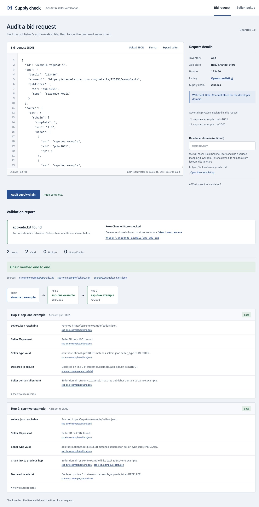

# Ads.txt ↔ Sellers.json Validator

A small web tool that verifies a publisher's declared monetization rights by cross-referencing two IAB Tech Lab transparency files: the publisher's `ads.txt` and each ad system's `sellers.json`.

The app has two workspaces:

- **Bid request** — paste or upload an OpenRTB bid request. The tool finds the publisher's `ads.txt` (or the app developer's `app-ads.txt`, looked up from the app's store listing) and audits every hop of the declared supply chain.
- **Seller lookup** — enter an `ads.txt` URL and an account/seller ID to compare the matching declarations with each ad system's `sellers.json`.



## Supported app stores

For app inventory, the bid request rarely says where `app-ads.txt` lives. When `app.domain` is missing, the server finds the developer's domain from the store named by `app.storeurl`:

| Store | Recognized `app.storeurl` hosts | Where the developer domain comes from | Verified fallback |
|---|---|---|---|
| Apple App Store | `apps.apple.com`, `itunes.apple.com` | Apple's lookup API (`sellerUrl`) | — |
| Google Play | `play.google.com` | The listing's `appstore:developer_url` meta tag | — |
| Roku Channel Store | `channelstore.roku.com` | The listing's `appstore:developer_url` meta tag | — |
| LG Content Store | `lgappstv.com` | The listing's `appstore:developer_url` meta tag | Philo (`appId=1244756`) → `philo.com` |
| Samsung Apps | `samsung.com` | The listing's `appstore:developer_url` meta tag | — |
| Vizio App Catalog | `vizio.com` (`/en/smart-tv-apps`) | The matching catalog entry's `data-developer-url` | WatchFree+ (`vizio.watchfree`) → `www.vizio.com` |
| Amazon Appstore (Fire TV) | `amazon.com`, or an ASIN bundle with no store URL | The listing's `appstore:developer_url` meta tag | Tubi (`B075NTHVJW`) → `tubitv.com` |

Store hosts match exactly or as a true subdomain (`www.amazon.com` qualifies, `amazon.com.example` does not). The meta tag is trusted only because the page is the store's own. Live store metadata always takes precedence over a fallback. A fallback is used only when the store lookup gives no domain, and each one was checked by hand against the developer's own site and live `app-ads.txt`.

Store details:

- **Apple:** numeric App Store IDs and reverse-DNS bundle IDs are both handled. The bundle is tried first, then the `/id<digits>` from the store URL.
- **Roku, LG and other numeric IDs:** a bundle is looked up only in the store its URL names. A numeric Roku or LG ID is never sent to Apple, where it could match an unrelated iOS app.
- **Package mappings:** a curated mapping (currently `tv.pluto.android` → `pluto.tv`) resolves a request with no recognized store URL. If the request has a store URL, that store is queried first and the mapping is used only if the lookup fails.
- **Bundle with no recognized store URL:** if no mapping applies, the bundle is tried against Apple's lookup API.

If the domain still can't be found, the panel asks for it.

**Download limits.** Store HTML downloads allow up to 4 MiB of decompressed content, since normal Amazon listings exceed 1 MiB. The separate `ads.txt` and `app-ads.txt` limit remains 512 KiB. A page over its limit is rejected without retrying the same hostname's other addresses. Redirect validation, DNS pinning and request deadlines still apply.

## Bid request supply-chain audit

The **Bid request** workspace audits a pasted or uploaded OpenRTB 2.x bid request instead of a bare ads.txt URL and account ID. Paste the JSON or drop a `.json` file (up to 5 MB). The browser keeps only `id`, `site`, `app`, `dooh` and `source`, and those are the only fields sent to the server. `device`, `user`, `regs` and `imp` never leave the page.

The editor:

- formats valid JSON on paste or upload and shows line numbers
- has a **Format** button that adjusts whitespace without changing numeric IDs or string contents
- has an **Expand editor** button for the full workspace width
- audits on **⌘/Ctrl + Enter**

The **Request details** inspector shows:

- the inventory type, app store, bundle and store listing
- the number of supply-chain nodes
- the advertising systems declared in the request, listed separately from the app store

### Where the authorization file comes from

| Inventory | File | Domain source |
|---|---|---|
| Site | `ads.txt` | `site.domain` (a full URL there is reduced to its host), else the host of `site.page` |
| App | `app-ads.txt` | `app.domain`, else the app-store lookup described in [Supported app stores](#supported-app-stores) |
| DOOH | `ads.txt` | `dooh.domain` |

When the domain isn't in the request, the inspector shows a domain field:

- **Recognized store:** the field is marked optional. The server checks the store itself, and entering a domain skips the store lookup.
- **No recognized store:** the domain is required.
- **Failed lookup:** an expanded editor returns to its normal layout so the domain field is visible, and the error message explains why the lookup failed.

If the request declares no supply chain, the panel hands you to the **Seller lookup** workspace, which takes a full URL and account ID.

### Discovery report

Above the chain results, a discovery report:

- names the store actually checked, or says **not queried** if it wasn't
- says whether the authorization file was retrieved, with a link to it
- says where the domain came from: store metadata, a verified app mapping, the bid request itself, or your manual entry

A failed lookup or download still shows which store was checked. For example, `lgads.tv` in a Fire TV request is a declared advertising system, not the app store.

### Chain checks

The server walks every node in the bid request's supply chain object (`source.ext.schain`, preferred, or `source.schain`). For each hop, it checks:

- the ad system's `sellers.json` is reachable
- the seller ID from the chain node is present in it
- the declared `seller_type` agrees with the actual ads.txt relationship: a complete chain needs a `DIRECT` first hop, and later hops need `RESELLER`
- the hop's seller domain links back to the previous hop's ad system domain (the chain link check)
- the hop is declared in the publisher's or app developer's `ads.txt`/`app-ads.txt`
- a complete chain's first seller aligns with the business identity of the authorizing file: its `OWNERDOMAIN`, or its host when that variable is absent

When the request names an inventory partner (`site.inventorypartnerdomain` / `app.inventorypartnerdomain`, OpenRTB 2.6, or their `site.ext.inventorypartnerdomain` / `app.ext.inventorypartnerdomain` equivalents), the audit also checks the partner arrangement. A nonempty direct field takes precedence; the `ext` field is used when the direct field is absent or blank.

- The owner's file must carry an `INVENTORYPARTNERDOMAIN=<partner>` line authorizing it.
- A hop counts as declared if either the owner's file or the partner's `ads.txt` lists it.
- The partner always uses `ads.txt`, including for app inventory.

Each hop is rendered as `pass`, `broken` or `unverifiable`. `unverifiable` is not a soft failure: it means the hop genuinely could not be checked, for example because of a confidential seller record or an unreachable `sellers.json`.

The result is shown as a flow diagram plus per-hop detail, with links back to every `ads.txt`/`app-ads.txt` and `sellers.json` source file used. **View source records** shows the raw `sellers.json` record and `ads.txt` line for each hop.

An incomplete chain (`complete: 0`, or no completeness flag) can start at a reseller. Its known hops are checked, but the chain stays `unverifiable` unless a confirmed failure makes it `broken`.

- Malformed nodes fail the chain.
- Chains are capped at 32 nodes. Nodes beyond the cap are dropped with a warning and prevent an end-to-end pass.
- A network failure never erases a known authorization failure.

### Time budget and cancellation

The audit's time budget (`AUDIT_BUDGET_MS`) covers app resolution, authorization files and seller lookups:

- If it expires during preparation, the server returns a timeout error.
- If it expires during the chain walk, the server returns the partial audit with an explanation.

The two workspaces share one active request:

- **Cancel** stops whichever operation is running.
- Switching tabs cancels any pending lookup and clears the shared report, but keeps both forms' inputs.
- A caller can stop waiting for a shared `sellers.json` fetch without cancelling it for other callers.

## Seller lookup checks

For each matching `ads.txt` entry, the **Seller lookup** workspace reports one of four statuses:

| Status | Meaning |
|---|---|
| **Valid** | The `ads.txt` relationship matches the `seller_type` declared in `sellers.json`. |
| **Mismatch** | Both files list the seller, but the relationship and `seller_type` disagree. |
| **Not Found** | The seller ID is absent from the ad system's `sellers.json`. |
| **Unreachable** | The `sellers.json` file could not be fetched, parsed, or validated. |

The relationship rules applied are:

- `DIRECT` in `ads.txt` expects `PUBLISHER` or `BOTH` in `sellers.json`
- `RESELLER` in `ads.txt` expects `INTERMEDIARY` or `BOTH` in `sellers.json`

Alongside the status, each result also surfaces:

- **Domain alignment** — whether the seller's declared `domain` matches the publisher domain the `ads.txt` was served from
- **Confidential sellers** — entries flagged `is_confidential: 1`, where the ad system withholds seller name and domain
- **Endpoint used** — whether the standard `https://{adsystem}/sellers.json` path was used or a known non-standard override (Google, for example, publishes its `sellers.json` from a Google Cloud Storage endpoint)
- **Raw source line** — the original `ads.txt` line and its line number

## Why it needs a server

Most adtech servers do not send CORS headers, so a browser cannot fetch `ads.txt`, `sellers.json` or app-store pages directly from another origin. All outbound requests are therefore proxied through the Express backend. A purely static version of this tool is not possible.

## Requirements

- **Node.js 18 or newer** (uses `net.BlockList`, `String.prototype.replaceAll`, and the built-in `node --test` runner)
- **npm** (ships with Node.js)
- Outbound HTTPS internet access — the server fetches live `ads.txt`, `app-ads.txt`, `sellers.json` and app-store listing pages

No database, API keys, or accounts are required.

## Setup

```bash
git clone https://github.com/willlightningstrike/ads_txt_scraper.git
```

```bash
cd ads_txt_scraper
```

```bash
npm install
```

## Running the app

Start the server:

```bash
npm start
```

Then open **http://localhost:3000** in your browser.

For development with automatic restarts on file changes:

```bash
npm run dev
```

To stop the server, press `Ctrl+C` in the terminal.

## Using it

### Audit a bid request

1. Open the **Bid request** tab (the default).
2. Paste a bid request into **Bid request JSON**, or click **Upload JSON** or drop a `.json` file onto the editor.
3. Check **Request details**. If the domain field appears and is required, enter the publisher or app developer domain (for example `example.com`).
4. Click **Audit supply chain**, or press **⌘/Ctrl + Enter**.
5. Read the discovery report, then the chain summary, flow diagram and per-hop checks.

### Look up a seller

1. Open the **Seller lookup** tab.
2. Enter an `ads.txt` URL. It must be a full **HTTPS** URL, for example `https://www.example-publisher.com/ads.txt`.
3. Enter the account or seller ID you want to verify, for example `pub-1234567890`.
4. Click **Validate seller**.
5. Review the summary counts at the top, then the per-entry cards below. Click **Copy report JSON** to copy the full result (available for seller lookups only).

If the seller ID does not appear anywhere in the `ads.txt` file, the report says so and no `sellers.json` lookups are performed.

## Running the tests

```bash
npm test
```

The suite runs on Node's built-in `node --test` runner and currently has 282 tests across fourteen files. It covers:

- the SSRF/URL-validation layer: private IP detection, IPv6 handling, DNS pinning
- ads.txt and sellers.json parsing, and the `sellers.json` LRU/TTL cache
- OpenRTB bid-request extraction and supply-chain auditing
- app-developer-domain resolution for every supported store, including:
  - store lookups taking precedence over package mappings
  - the verified fallbacks
  - Vizio catalog matching
  - Fire TV ASINs and blocked Amazon listings
  - large store pages and decompressed download limits
- route-level tests for both APIs
- audit deadlines and lookup-outcome reporting
- lossless JSON formatting and editor controls
- cancellation and overlapping requests

## Configuration

All settings are optional environment variables:

| Variable | Default | Purpose |
|---|---|---|
| `PORT` | `3000` | Server listen port |
| `HOST` | `127.0.0.1` | Server bind address |
| `REQUEST_TIMEOUT_MS` | `20000` | Timeout for outbound HTTP requests |
| `MAX_JSON_BYTES` | `134217728` (128 MiB) | Max `sellers.json` response size |
| `MAX_CACHEABLE_JSON_BYTES` | `10485760` (10 MiB) | Max `sellers.json` size eligible for caching |
| `SELLERS_CACHE_SIZE` | `10` | Number of `sellers.json` files held in the LRU cache |
| `MAX_CONCURRENT_LOOKUPS` | `6` | Max `sellers.json` fetches in flight for one validation |
| `AUDIT_BUDGET_MS` | `120000` (120 s) | Deadline for `/api/audit-chain` resolution, file retrieval and chain checks |

Example:

```bash
PORT=8080 HOST=0.0.0.0 npm start
```

Note that `HOST` defaults to `127.0.0.1`, so the server is only reachable from the local machine unless you change it.

## How it works

### Seller lookup

1. The browser POSTs `{ adsTxtUrl, accountId }` to `POST /api/validate`.
2. The server validates the URL, fetches the `ads.txt` file, and parses it into entries.
3. Entries whose account ID matches the input are kept; the rest are ignored.
4. For each match, the server fetches `https://{adSystemDomain}/sellers.json` (or a known override URL).
5. The seller ID is looked up in the `sellers` array and the relationship is validated.
6. The server returns the results as JSON, with the domain-alignment and confidentiality checks and a summary tally, and the UI renders them.

Rows with an empty ad system domain or account ID are skipped, since neither can identify anything to look up. A row whose relationship is neither `DIRECT` nor `RESELLER` is kept and reported as a mismatch rather than dropped silently.

The domain check reports `match` only when the seller domain and publisher domain are identical. A parent/child suffix relationship is reported as `related` instead. Telling a real subdomain from two unrelated tenants under a public suffix such as `github.io` would require the Public Suffix List, so the weaker claim is the honest one.

If the browser cancels, times out, or navigates away, the server stops issuing the remaining `sellers.json` lookups instead of running the whole fan-out for a result nobody can read.

`sellers.json` responses are cached in memory for one hour under an LRU cache, so repeat lookups against the same ad system are fast. The cache is per-process and is cleared on restart. Lookups run at most `MAX_CONCURRENT_LOOKUPS` at a time, and matches that share one `sellers.json` endpoint share a single in-flight request rather than each issuing their own.

### Bid request audit

1. The browser reduces the bid request to `id`, `site`, `app`, `dooh` and `source` and POSTs it to `POST /api/audit-chain`.
2. The server extracts the inventory origin and the supply chain.
3. It resolves the origin domain from the request, the app store, a verified fallback, or the user's override.
4. It fetches the authorization file, plus the inventory partner's `ads.txt` when one is named.
5. It walks the chain hop by hop against each ad system's `sellers.json`, sharing the same cache as Seller lookup.
6. It returns the per-hop results, chain-level checks, source links and a discovery report.

### API

The backend can also be called directly:

```bash
curl -X POST http://localhost:3000/api/validate -H "Content-Type: application/json" -d '{"adsTxtUrl":"https://www.example-publisher.com/ads.txt","accountId":"pub-1234567890"}'
```

`POST /api/audit-chain` takes a reduced bid request and returns the supply-chain audit described above. Add an optional `originDomainOverride` when the publisher or app domain can't be resolved automatically. The body limit is 512 KB.

```bash
curl -X POST http://localhost:3000/api/audit-chain -H "Content-Type: application/json" -d '{"bidRequest":{"site":{"domain":"example-publisher.com"},"source":{"ext":{"schain":{"nodes":[{"asi":"exchange.example","sid":"pub-1234567890"}]}}}}}'
```

Error responses:

| Status | `reason` | When |
|---|---|---|
| 422 | `no_schain` | The bid request declares no supply chain. |
| 422 | `origin_domain_required` | The publisher or app domain couldn't be resolved and no override was supplied. |
| 504 | `audit_budget_exceeded` | The time budget ran out while resolving the origin or fetching authorization files. |

For a failed store lookup, the 422 response also includes `resolutionError`, with a `code` (`amazon_challenge` or `store_page_too_large`) and a user-facing `message`. The top-level `error` repeats that message, and `reason` still points to the manual-domain workflow.

Once the inventory origin has been extracted, success and failure responses include a `discovery` object:

| Field | Contents |
|---|---|
| `store`, `storeUrl` | The identified store and its URL |
| `lookupAttempted` | Whether the store was queried |
| `domain`, `resolvedFrom` | The resolved domain and how it was found: `app.domain`, `site.domain`, `site.page`, `dooh.domain`, `store-listing`, `itunes`, `known-map` or `user` |
| `file`, `fileUrl` | The authorization file and its URL |
| `fileStatus` | `not_requested`, `fetching`, `fetched` or `failed` |

A successful file fetch is separate from the supply-chain verdict and does not imply seller authorization.

A health check is available at `GET /api/health`.

## Security notes

Because the server fetches URLs supplied by the user, it includes SSRF protections. Every outbound URL must satisfy all of the following:

- HTTPS only, on port 443
- No credentials embedded in the URL
- No `localhost`, `.localhost`, or `.local` hostnames
- Hostnames are resolved via DNS, and every resolved address is checked against private, loopback, link-local and other special-use IPv4 and IPv6 ranges before any request is made. This includes `0.0.0.0/8`, CGNAT, multicast, reserved space, and IPv4-mapped IPv6 forms.
- Connections are pinned to the already-validated IP address to prevent DNS rebinding, and proxy environment variables are ignored so they cannot re-resolve the hostname around that pin
- Redirects are followed manually, with each hop re-validated, capped at 4 hops (5 requests)
- Response sizes are capped

The server sends no CORS headers, so only the frontend it serves can call the API — other pages in your browser cannot use it to drive outbound fetches.

All user-supplied strings are HTML-escaped before being inserted into the page.

## Project structure

```
server.js                          Express routes: /api/validate, /api/audit-chain, wiring for lib/
lib/validation.js                  Domain comparison, seller-type validation, summary tallies
lib/ads-txt.js                     ads.txt parsing, including variables (OWNERDOMAIN, INVENTORYPARTNERDOMAIN)
lib/http-client.js                 SSRF-safe outbound fetch: URL validation, DNS pinning, redirects, size limits
lib/abort.js                       Bound a caller's wait without cancelling shared work
lib/sellers-json.js                sellers.json fetch + in-memory LRU/TTL cache
lib/ortb.js                        Bid-request origin/schain extraction (site/app/dooh)
lib/app-domain.js                  App developer-domain resolution: Apple lookup API, store-listing
                                    metadata, Vizio catalog, verified fallbacks
lib/chain-audit.js                 Per-hop and whole-chain supply-chain audit logic
public/index.html                  UI markup: Bid request and Seller lookup workspaces, shared report
public/app.js                      Seller lookup form, tabs, shared request lifecycle and report rendering
public/ortb-panel.js               Bid-request editor, request inspector, discovery report and chain-audit rendering
public/bid-request-extract.js      Client-side reduction of a bid request to allowed fields; lossless JSON formatting
public/style.css                   Styles
docs/screenshot.jpg                README screenshot
test/                              282 tests across fourteen files (node --test), including route,
                                    store-resolution, audit-budget and frontend request-lifecycle tests
```

## License

[MIT](LICENSE) © 2026 willlightningstrike
